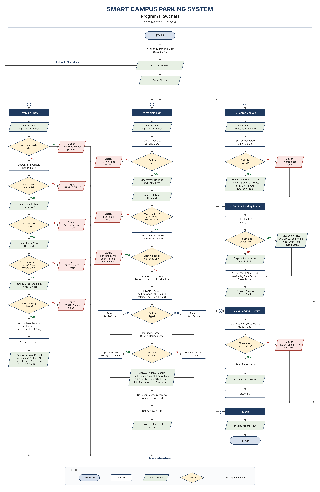

# Smart Campus Parking System

## C Programming Mini Hackathon

**Team Name:** Team Rocket  
**Batch:** 43  
**Problem Statement:** Problem Statement 5 - Smart Campus Parking System

## Team Members

| Name | SAP ID |
|---|---|
| Lakshya Garg | 590039884 |
| Nishchal Khatri | 590038447 |
| Sanskar Singh | 590038463 |

---

## 1. Problem Statement

Design a parking management program that tracks vehicle entry, exit, and available parking spaces.

The system maintains a fixed number of parking spaces, records vehicle registration numbers and entry times, calculates parking charges based on parking duration, prevents duplicate vehicle entry, and reports when the parking area is full.

---

## 2. Objective

The objective of this project is to develop a simple menu-driven Smart Campus Parking System using C programming.

The program helps manage a campus parking area by:

- Recording vehicle entry.
- Assigning an available parking slot.
- Recording the entry time of a vehicle.
- Preventing duplicate vehicle entries.
- Tracking occupied and available parking spaces.
- Searching for a parked vehicle.
- Processing vehicle exit.
- Calculating parking duration and parking charges.
- Making the parking slot available again after vehicle exit.
- Displaying a message when the parking area is full.

---

## 3. Features

### Vehicle Entry

The user enters a vehicle registration number and entry time. The program automatically searches for the first available parking slot and assigns it to the vehicle.

### Duplicate Entry Prevention

Before parking a vehicle, the program checks whether the same vehicle registration number is already present.

If it is already parked, the program displays:

```text
Vehicle is already parked!
```

### Parking Full Detection

The system maintains a maximum of 10 parking spaces.

If all parking spaces are occupied, the program displays:

```text
PARKING FULL!
```

### Vehicle Exit

The user enters the registration number of the parked vehicle and its exit time.

The program calculates:

```text
Parking Duration = Exit Time - Entry Time
```

### Parking Charge

The parking rate used in the program is:

```text
Rs. 20 per hour
```

The charge is calculated using:

```text
Parking Charge = Parking Duration x Rate Per Hour
```

A minimum duration of one hour is considered for calculating the parking charge.

### Search Vehicle

The user can search for a vehicle using its registration number.

If found, the program displays:

- Vehicle registration number
- Parking slot
- Entry time
- Current status

### Parking Status

The program displays all 10 parking spaces and shows whether each slot is:

```text
OCCUPIED
```

or:

```text
AVAILABLE
```

It also displays the total number of occupied and available parking spaces.

---

## 4. C Programming Concepts Used

The project uses the following C programming concepts:

- Variables and constants
- Data types
- Operators
- Conditional statements (`if`, `else`)
- `switch` statement
- `for` loops
- `do-while` loop
- Arrays
- Character arrays and strings
- Structures
- Array of structures
- Functions
- Function prototypes
- String functions such as `strcmp()` and `strcpy()`

---

## 5. Data Structure Used

A structure named `ParkingSlot` is used to store the information related to each parking space.

```c
struct ParkingSlot
{
    char vehicleNumber[20];
    int entryTime;
    int occupied;
};
```

Each parking slot stores:

- `vehicleNumber` - registration number of the parked vehicle.
- `entryTime` - time at which the vehicle entered.
- `occupied` - current status of the parking slot.

The value of `occupied` is used as:

```text
0 = Available
1 = Occupied
```

An array of structures represents the complete parking area:

```c
struct ParkingSlot parking[MAX_SLOTS];
```

The program uses 10 parking slots.

---

## 6. Algorithm

1. Start the program.
2. Create an array of 10 parking slots.
3. Initialize the `occupied` status of every parking slot to `0`.
4. Display the main menu.
5. Accept the user's choice.
6. If the user selects **Vehicle Entry**:
   - Accept the vehicle registration number.
   - Check whether the vehicle is already parked.
   - If already parked, display an error message.
   - Search for the first available parking slot.
   - If no slot is available, display `PARKING FULL`.
   - Accept and validate the entry time.
   - Store the vehicle registration number and entry time.
   - Mark the selected parking slot as occupied.
7. If the user selects **Vehicle Exit**:
   - Accept the vehicle registration number.
   - Search for the vehicle.
   - If the vehicle is not found, display an error message.
   - Accept and validate the exit time.
   - Calculate the parking duration.
   - Calculate the parking charge.
   - Display the parking receipt.
   - Mark the parking slot as available.
8. If the user selects **Search Vehicle**:
   - Accept the vehicle registration number.
   - Search through the occupied parking slots.
   - Display the vehicle information if found.
   - Otherwise, display `Vehicle not found`.
9. If the user selects **Display Parking Status**:
   - Check every parking slot.
   - Display whether each slot is occupied or available.
   - Count and display the occupied and available spaces.
10. Repeat the menu until the user selects **Exit**.
11. Stop.

---

## 7. Pseudocode

```text
START

Create parking array with 10 slots

FOR every parking slot
    Set occupied = 0
END FOR

DO

    Display main menu
    Input choice

    SWITCH choice

        CASE 1: VEHICLE ENTRY

            Input vehicle number

            FOR every parking slot
                IF slot is occupied AND vehicle number matches
                    Display "Vehicle is already parked"
                    Return to menu
                END IF
            END FOR

            Search for first available slot

            IF no available slot exists
                Display "PARKING FULL"
                Return to menu
            END IF

            Input entry time

            IF entry time is invalid
                Display error
                Return to menu
            END IF

            Store vehicle number
            Store entry time
            Set occupied = 1

            Display parking confirmation

        CASE 2: VEHICLE EXIT

            Input vehicle number
            Search for vehicle

            IF vehicle is not found
                Display "Vehicle not found"
                Return to menu
            END IF

            Input exit time

            IF exit time is invalid
                Display error
                Return to menu
            END IF

            Calculate duration

            IF duration = 0
                Set duration = 1
            END IF

            Calculate parking charge
            Display parking receipt
            Set occupied = 0

        CASE 3: SEARCH VEHICLE

            Input vehicle number
            Search all occupied slots

            IF vehicle is found
                Display vehicle details
            ELSE
                Display "Vehicle not found"
            END IF

        CASE 4: DISPLAY PARKING STATUS

            FOR every parking slot

                IF occupied = 1
                    Display "OCCUPIED"
                ELSE
                    Display "AVAILABLE"
                END IF

            END FOR

            Display total occupied slots
            Display total available slots

        CASE 5:

            Display exit message

        DEFAULT:

            Display "Invalid choice"

    END SWITCH

WHILE choice is not 5

STOP
```

---

## 8. Program Functions

The program is divided into four main functions.

### `vehicleEntry()`

```c
void vehicleEntry(struct ParkingSlot parking[]);
```

This function:

- Accepts the vehicle registration number.
- Checks for duplicate entry.
- Searches for an empty parking slot.
- Detects when the parking area is full.
- Accepts the entry time.
- Stores the vehicle information.
- Marks the parking slot as occupied.

### `vehicleExit()`

```c
void vehicleExit(struct ParkingSlot parking[]);
```

This function:

- Searches for the vehicle.
- Accepts the exit time.
- Calculates the parking duration.
- Calculates the parking charge.
- Displays the parking receipt.
- Makes the parking slot available again.

### `searchVehicle()`

```c
void searchVehicle(struct ParkingSlot parking[]);
```

This function searches for a vehicle using its registration number and displays its parking details.

### `displayParking()`

```c
void displayParking(struct ParkingSlot parking[]);
```

This function displays the status of every parking slot and the total number of occupied and available spaces.

---

## 9. Parking Charge Calculation

The parking rate is defined using:

```c
#define RATE_PER_HOUR 20
```

Parking duration is calculated using:

```c
duration = exitTime - parking[slot].entryTime;
```

The parking charge is calculated using:

```c
charge = duration * RATE_PER_HOUR;
```

### Example

If a vehicle enters at:

```text
10:00
```

and exits at:

```text
14:00
```

then:

```text
Duration = 14 - 10
         = 4 hours

Parking Charge = 4 x 20
               = Rs. 80
```

---

## 10. Compilation and Execution

The program can be compiled using Clang.

### Compile

```bash
clang smart_campus_parking.c -o smart_campus_parking
```

### Run

```bash
./smart_campus_parking
```

---

## 11. Test Cases

| Test Case | Input | Expected Output | Actual Output | Result |
|---|---|---|---|---|
| Normal Vehicle Entry | `DL5CAB1234`, Entry: `10` | Vehicle parked successfully | Vehicle parked successfully | Pass |
| Second Vehicle Entry | `UK07AB5678`, Entry: `12` | Vehicle assigned next available slot | Vehicle assigned next available slot | Pass |
| Duplicate Entry | Enter `DL5CAB1234` again | Vehicle is already parked | Vehicle is already parked | Pass |
| Search Existing Vehicle | Search `DL5CAB1234` | Vehicle details displayed | Vehicle details displayed | Pass |
| Search Unknown Vehicle | Search `UP14XY9999` | Vehicle not found | Vehicle not found | Pass |
| Normal Vehicle Exit | `DL5CAB1234`, Exit: `14` | Duration = 4 hours, Charge = Rs. 80 | Duration = 4 hours, Charge = Rs. 80 | Pass |
| Invalid Entry Time | Entry: `27` | Invalid entry time | Invalid entry time | Pass |
| Invalid Exit Time | Exit: `25` | Invalid exit time | Invalid exit time | Pass |
| Exit Before Entry | Entry: `15`, Exit: `10` | Exit time cannot be earlier than entry time | Exit time cannot be earlier than entry time | Pass |
| Parking Full | Attempt another entry after all 10 slots are occupied | PARKING FULL | PARKING FULL | Pass |

---

## 12. Sample Output - Vehicle Entry

```text
--- VEHICLE ENTRY ---

Enter vehicle registration number: DL5CAB1234
Enter entry time (0-23): 10

Vehicle parked successfully!
Vehicle Number : DL5CAB1234
Parking Slot   : 1
Entry Time     : 10:00
```

---

## 13. Sample Output - Search Vehicle

```text
--- SEARCH VEHICLE ---

Enter vehicle registration number: DL5CAB1234

Vehicle found!
Vehicle Number : DL5CAB1234
Parking Slot   : 1
Entry Time     : 10:00
Status         : Parked
```

---

## 14. Sample Output - Vehicle Exit

```text
--- VEHICLE EXIT ---

Enter vehicle registration number: DL5CAB1234
Entry Time: 10:00
Enter exit time (0-23): 14

========== PARKING RECEIPT ==========
Vehicle Number : DL5CAB1234
Parking Slot   : 1
Entry Time     : 10:00
Exit Time      : 14:00
Duration       : 4 hour(s)
Parking Charge : Rs. 80.00
=====================================
Vehicle exited successfully!
```

---

## 15. Sample Output - Parking Status

```text
========== PARKING STATUS ==========

Slot 1 : OCCUPIED - DL5CAB1234
Slot 2 : OCCUPIED - UK07AB5678
Slot 3 : AVAILABLE
Slot 4 : AVAILABLE
Slot 5 : AVAILABLE
Slot 6 : AVAILABLE
Slot 7 : AVAILABLE
Slot 8 : AVAILABLE
Slot 9 : AVAILABLE
Slot 10 : AVAILABLE

------------------------------------
Total Slots     : 10
Occupied Slots  : 2
Available Slots : 8
====================================
```

---
---

## 16. Program Flowchart

The following flowchart represents the overall working of the Smart Campus Parking System.



---

## 17. Project Files

- [View Program Flowchart](Flowchart.png)
- [Download Project Presentation](Presentation.pptx)

---
## 18. Limitations

The current program is designed as a simple first-year C programming project.

- Parking information is stored only while the program is running.
- Data is not saved permanently after the program is closed.
- Time is represented using whole hours from `0` to `23`.
- The program assumes that vehicle entry and exit occur on the same day.
- The system uses a fixed parking rate of Rs. 20 per hour.

---

## 19. Conclusion

The Smart Campus Parking System demonstrates how fundamental C programming concepts can be applied to a practical campus parking problem.

The program manages vehicle entry and exit, prevents duplicate entries, detects a full parking area, searches for parked vehicles, calculates parking charges, and displays parking availability.

The project uses structures, arrays, strings, loops, conditional statements, functions, and menu-driven programming to provide a simple and functional parking management solution.

---

## Team Rocket

**Batch 43**

| Team Member | SAP ID |
|---|---|
| Lakshya Garg | 590039884 |
| Nishchal Khatri | 590038447 |
| Sanskar Singh | 590038463 |