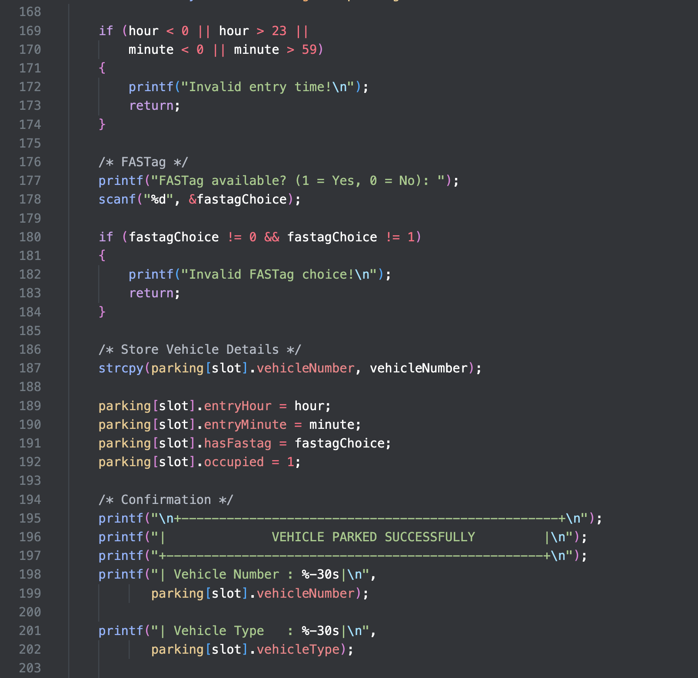
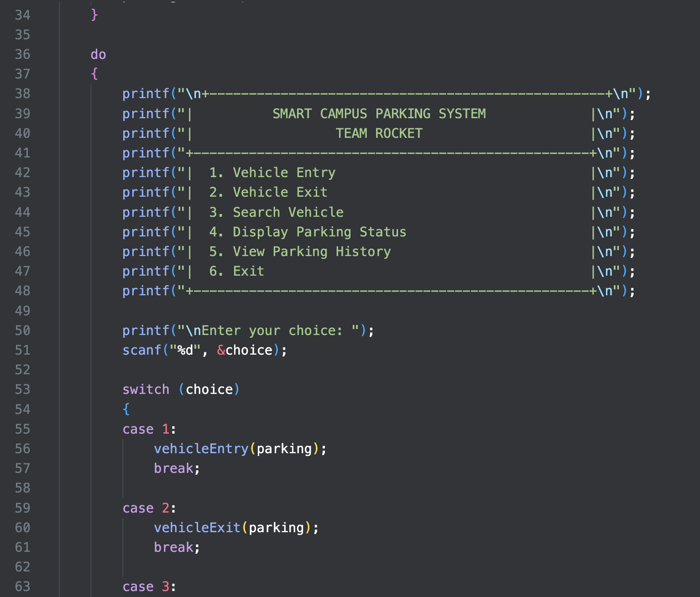
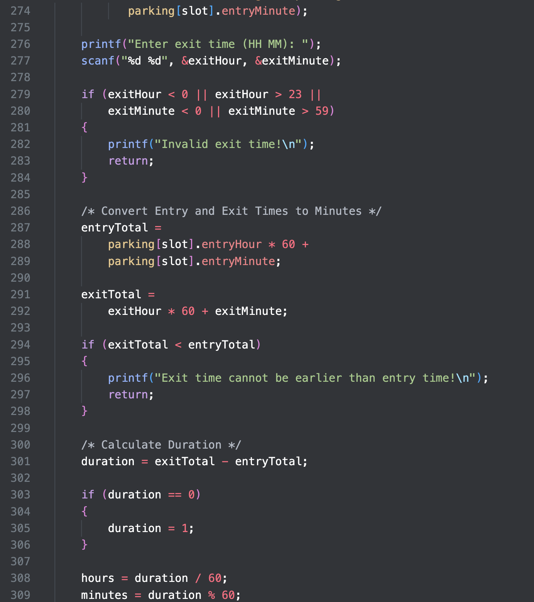
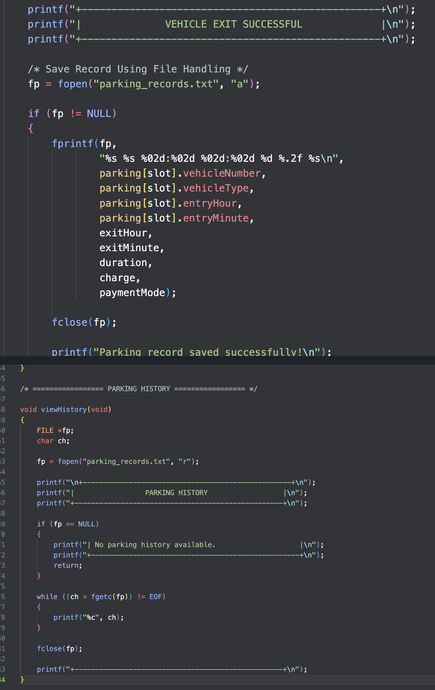
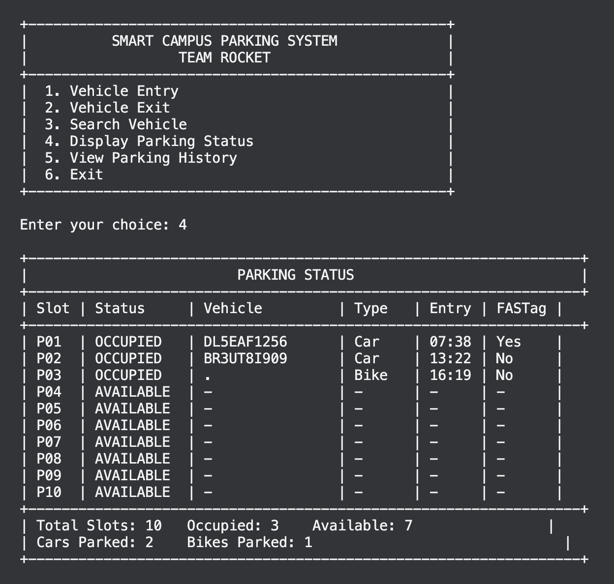
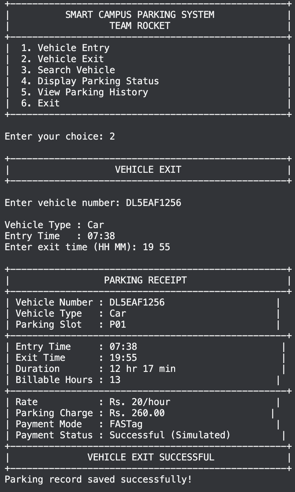

# Smart Campus Parking System

A menu-driven **Smart Campus Parking System developed in C** for the C Programming Mini Hackathon.

The system manages vehicle entry and exit, tracks parking availability, supports cars and bikes with different parking rates, calculates parking duration using HH:MM time, provides a **simulated FASTag/Cash payment workflow**, and stores completed parking records using C file handling.

---

## Team Details

**Team Name:** Team Rocket  
**Batch:** 43  
**Problem Statement:** 5 — Smart Campus Parking System

| Team Member | SAP ID |
|---|---:|
| Lakshya Garg | 590039884 |
| Nishchal Khati | 590038447 |
| Sanskar Singh | 590038463 |

---

## Objective

The objective is to develop a practical parking-management prototype using fundamental C programming concepts. The system manages vehicle entry and exit, tracks occupied and available slots, prevents duplicate entries, detects a full parking area, supports cars and bikes, calculates parking charges, and stores completed transactions using file handling.

---

## Features

- 10 fixed parking slots
- Vehicle Entry and Vehicle Exit
- Search Vehicle
- Display Parking Status
- View Parking History
- Duplicate-entry prevention
- Parking-full detection
- Car and Bike support
- **Car rate:** Rs. 20/hour
- **Bike rate:** Rs. 10/hour
- HH:MM entry and exit time
- Every started hour charged as a complete hour
- Simulated FASTag/Cash payment
- File handling using `parking_records.txt`

> **Note:** FASTag payment is simulated. The program is not connected to the real FASTag/NPCI/banking network.

---

## Main Menu

```text
1. Vehicle Entry
2. Vehicle Exit
3. Search Vehicle
4. Display Parking Status
5. View Parking History
6. Exit
```

---

## Data Structure Used

Each parking slot is represented using a structure:

```c
struct ParkingSlot
{
    char vehicleNumber[20];
    char vehicleType[10];
    int entryHour;
    int entryMinute;
    int occupied;
    int hasFastag;
};
```

An array of 10 structures represents the complete parking area. `occupied = 0` means available and `occupied = 1` means occupied.

---

## C Concepts Used

Structures, arrays, strings, functions, loops, `if-else`, `switch`, `strcmp()`, `strcpy()`, and file handling using `FILE *`, `fopen()`, `fprintf()`, `fgetc()`, and `fclose()`.

---

## Program Workflow

### Vehicle Entry

1. Accept the vehicle registration number.
2. Check whether the vehicle is already parked.
3. Search for the first available slot.
4. Select Car or Bike.
5. Enter and validate the HH:MM entry time.
6. Enter FASTag availability.
7. Store the vehicle details and set `occupied = 1`.

### Vehicle Exit

1. Search for the vehicle by registration number.
2. Enter and validate the HH:MM exit time.
3. Convert entry and exit times into minutes.
4. Calculate duration and billable hours.
5. Apply the Car/Bike rate and calculate the charge.
6. Select simulated FASTag or Cash payment.
7. Display the receipt.
8. Append the transaction to `parking_records.txt`.
9. Set `occupied = 0` to free the slot.

---

## Parking Charge Calculation

```c
entryTotal = parking[slot].entryHour * 60 + parking[slot].entryMinute;
exitTotal = exitHour * 60 + exitMinute;
duration = exitTotal - entryTotal;

billableHours = (duration + 59) / 60;
charge = billableHours * rate;
```

For example, a car parked from `07:38` to `19:55` stays for **12 hr 17 min**. This becomes **13 billable hours**, so the charge is **13 x Rs. 20 = Rs. 260**.

---

## Detailed Program Flowchart

The detailed flowchart contains the complete program logic, validations, payment selection, and file-handling flow.


---

# Coding Screenshots

Selected screenshots of the actual C source code are included below to explain the main implementation without reproducing every line of the program.

## 1. Main Menu and Program Control



### What this code does

The main menu is the control centre of the program. It is placed inside a `do-while` loop, which means the menu is displayed at least once and continues to appear until the user selects option `6`.

The entered value is stored in `choice` and handled using a `switch` statement. Each case calls a separate function:

- `vehicleEntry(parking)` — handles a new vehicle entering.
- `vehicleExit(parking)` — handles exit, duration, billing and record storage.
- `searchVehicle(parking)` — searches the occupied slots for a registration number.
- `displayParking(parking)` — displays the status of all 10 slots.
- `viewHistory()` — reads completed transactions from the record file.

The `break` statement prevents execution from falling into the next case. The `default` case handles invalid menu choices.

### Why this approach was used

Separating each operation into a function keeps `main()` simple and makes the program modular. Instead of writing the complete parking logic inside one large function, `main()` only controls which operation should run.

### C concepts demonstrated

`do-while` loop • `switch-case` • functions • arrays passed to functions • input/output • modular programming

---

## 2. Vehicle Entry Logic



### What this code does

The Vehicle Entry function begins by accepting a registration number into `vehicleNumber`.

The first `for` loop checks all 10 parking slots. A comparison is made only when a slot is already occupied:

```c
parking[i].occupied == 1
```

`strcmp()` then compares the stored registration number with the newly entered number. If `strcmp()` returns `0`, both strings are equal, so the vehicle is already inside the parking area. The program displays a warning and uses `return` to stop the entry operation immediately.

If no duplicate is found, another loop searches for the first slot whose `occupied` value is `0`. Its index is stored in `slot`.

`slot` is initially set to `-1`. Therefore, if it is still `-1` after checking all 10 slots, no empty slot was found and the program displays **PARKING FULL**.

After an empty slot is found, the user selects:

- Car or Bike
- Entry hour and minute
- FASTag availability

The time is validated so the hour remains between `0–23` and the minute between `0–59`.

The information is then stored inside the selected `ParkingSlot` structure and:

```c
parking[slot].occupied = 1;
```

marks the slot as occupied.

### Why this approach was used

The `occupied` flag allows one array to represent the complete parking lot. There is no need for a separate array of free slots. Duplicate checking also prevents the same registration number from occupying multiple slots.

### C concepts demonstrated

Array of structures • `for` loops • `if-else` • `strcmp()` • `strcpy()` • flags • validation • early `return`

---

## 3. Time, Rate and Charge Calculation



### What this code does

At exit, the program first validates the entered exit hour and minute.

Both the entry and exit times are converted into **total minutes from midnight**:

```c
entryTotal = parking[slot].entryHour * 60
             + parking[slot].entryMinute;

exitTotal = exitHour * 60 + exitMinute;
```

This makes time subtraction straightforward:

```c
duration = exitTotal - entryTotal;
```

The exact duration can then be separated into hours and minutes using division and modulus:

```c
hours = duration / 60;
minutes = duration % 60;
```

Because the project charges every **started hour** as a complete hour, billable hours are calculated as:

```c
billableHours = (duration + 59) / 60;
```

For example, `12 hr 17 min` becomes `13` billable hours.

The program checks `vehicleType` using `strcmp()`:

- Car → `CAR_RATE` = Rs. 20/hour
- Bike → `BIKE_RATE` = Rs. 10/hour

The final charge is:

```c
charge = billableHours * rate;
```

Finally, `hasFastag` determines the displayed payment mode. A value of `1` selects **FASTag (simulated)** and a value of `0` selects **Cash**.

### Why this approach was used

Working with total minutes avoids complicated separate hour/minute subtraction. The integer expression `(duration + 59) / 60` also rounds a partial hour upward without requiring the `math.h` library or `ceil()`.

### C concepts demonstrated

Arithmetic operators • integer division • modulus `%` • conditions • strings • constants • time validation • practical billing logic

---

## 4. File Handling



### Saving completed transactions

File handling gives the project a persistent record of vehicles that have completed their parking session.

The program declares:

```c
FILE *fp;
```

`fp` is a **file pointer** used to access the opened file.

When a vehicle exits successfully, the file is opened in append mode:

```c
fp = fopen("parking_records.txt", "a");
```

The `"a"` mode was selected because a new transaction should be added to the end of the file without deleting previous records.

The program checks:

```c
if (fp != NULL)
```

to make sure the file opened successfully.

`fprintf()` then writes the important transaction details, including:

- Vehicle registration number
- Vehicle type
- Entry time
- Exit time
- Duration in minutes
- Parking charge
- Payment mode

After writing, the file is closed using:

```c
fclose(fp);
```

### Reading Parking History

The `viewHistory()` function opens the same file in read mode:

```c
fp = fopen("parking_records.txt", "r");
```

If `fp == NULL`, the file could not be opened, so the program displays that no parking history is available.

Otherwise, the file is read one character at a time:

```c
while ((ch = fgetc(fp)) != EOF)
{
    printf("%c", ch);
}
```

`EOF` means **End Of File**. The loop stops after the final stored character is read, and `fclose(fp)` closes the file.

### Why this approach was used

The active parking slots exist in memory only while the program is running. File handling allows **completed transactions** to remain available after a vehicle exits and demonstrates persistent storage without requiring a database.

### C concepts demonstrated

`FILE *` • `fopen()` • append mode `"a"` • read mode `"r"` • `fprintf()` • `fgetc()` • `EOF` • `NULL` checking • `fclose()`

---

# Example Program Output

## Parking Status



### What the output shows

This screen gives a complete snapshot of the current 10-slot parking area.

Each row represents one slot. For an occupied slot, the program displays:

- Slot number
- `OCCUPIED` status
- Vehicle registration number
- Vehicle type
- HH:MM entry time
- FASTag availability

For an empty slot, the status is shown as `AVAILABLE`.

In the example screenshot:

- **3 slots are occupied**
- **7 slots are available**
- **2 cars are parked**
- **1 bike is parked**

The totals are calculated while the program traverses the same array of `ParkingSlot` structures used for entry and exit.

### What this proves

The screenshot demonstrates that the program can maintain several vehicles simultaneously and correctly distinguish between occupied and available slots, vehicle types and FASTag status.

---

## Vehicle Exit and Parking Receipt



### Step-by-step calculation

The example vehicle is a **Car** that entered at `07:38` and exited at `19:55`.

The program converts both times to minutes:

```text
07:38 = (7 x 60) + 38  = 458 minutes
19:55 = (19 x 60) + 55 = 1195 minutes
```

Therefore:

```text
Duration = 1195 - 458
         = 737 minutes
         = 12 hr 17 min
```

Since a started hour is charged as a complete hour:

```text
Billable Hours = 13
```

For a Car:

```text
Rate   = Rs. 20/hour
Charge = 13 x 20
       = Rs. 260
```

The receipt therefore correctly displays **Rs. 260.00**.

Because FASTag was selected during entry, the receipt shows:

```text
Payment Mode   : FASTag
Payment Status : Successful (Simulated)
```

After the receipt is generated, the completed transaction is appended to `parking_records.txt` and the slot's `occupied` value is reset to `0`.

### What this proves

This single output demonstrates vehicle search, HH:MM time handling, duration calculation, started-hour billing, vehicle-type pricing, simulated payment selection, file storage and freeing of the parking slot.

---

## File Handling and Parking History

Completed transactions are stored in `parking_records.txt`. Each stored record contains the vehicle number, vehicle type, entry time, exit time, duration in minutes, parking charge, and payment mode.

The file is opened in append mode (`"a"`) when saving records so previous transactions are not overwritten. The Parking History option opens it in read mode (`"r"`) and displays the stored records.

---

## Test Cases

| Test Case | Expected Result | Result |
|---|---|---|
| Normal Vehicle Entry | Vehicle assigned an available slot | PASS |
| Duplicate Vehicle Entry | Duplicate entry rejected | PASS |
| Car Parking Rate | Rs. 20/hour applied | PASS |
| Bike Parking Rate | Rs. 10/hour applied | PASS |
| HH:MM Time Calculation | Correct duration calculated | PASS |
| FASTag Available | FASTag shown as payment mode | PASS |
| FASTag Unavailable | Cash shown as payment mode | PASS |
| Parking Full | `PARKING FULL` displayed | PASS |
| Search Existing Vehicle | Vehicle details displayed | PASS |
| File Record Storage | Transaction stored | PASS |
| Parking History | Stored records displayed | PASS |

---

## Compilation and Execution

### Clang

```bash
clang smart_campus_parking.c -o parking
./parking
```

### GCC

```bash
gcc smart_campus_parking.c -o parking
./parking
```

---

## Project Structure

```text
Batch43_TeamRocket_SmartCampusParking/
|
|-- README.md
|-- smart_campus_parking.c
|-- parking_records.txt
|-- flowchart.png
|-- presentation.pptx
|
`-- screenshots/
    |-- code_main_menu.png
    |-- code_vehicle_entry.png
    |-- code_charge_calculation.png
    |-- code_file_handling.png
    |-- output_parking_status.png
    `-- output_vehicle_exit.png
```

---

## Limitations

- The prototype uses a fixed capacity of 10 parking slots.
- Current occupied-slot data resets when the program closes.
- Only completed transactions are permanently stored in the text file.
- Entry and exit are assumed to occur on the same day.
- FASTag payment is simulated.
- The system is terminal-based and does not use physical parking sensors.

---

## Conclusion

The Smart Campus Parking System demonstrates how fundamental C programming concepts can be combined into a practical application. It manages vehicle entry and exit, tracks parking availability, supports separate Car and Bike rates, calculates HH:MM-based parking duration, prevents duplicate entries, provides a simulated FASTag/Cash workflow, and stores completed transactions using C file handling.

---

**Team Rocket | Batch 43**  
**Lakshya Garg | Nishchal Khati | Sanskar Singh**
Smart_Campus_Parking_Whiteboard_FINAL